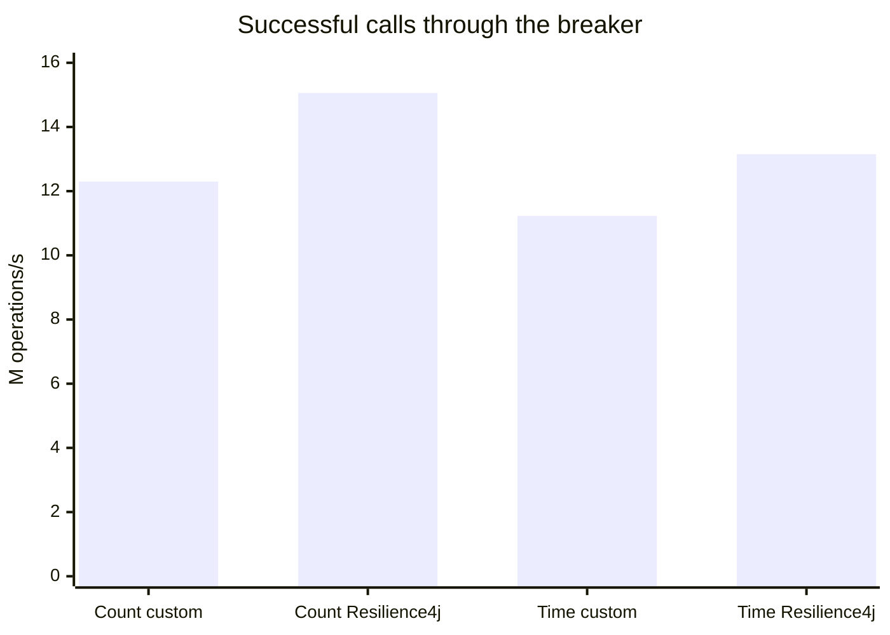

# Successful-call throughput

Millions of operations per second, one thread. The chart uses the throughput
scores in [`results.csv`](../results.csv); higher bars mean more completed calls
per second in this local JMH run.

